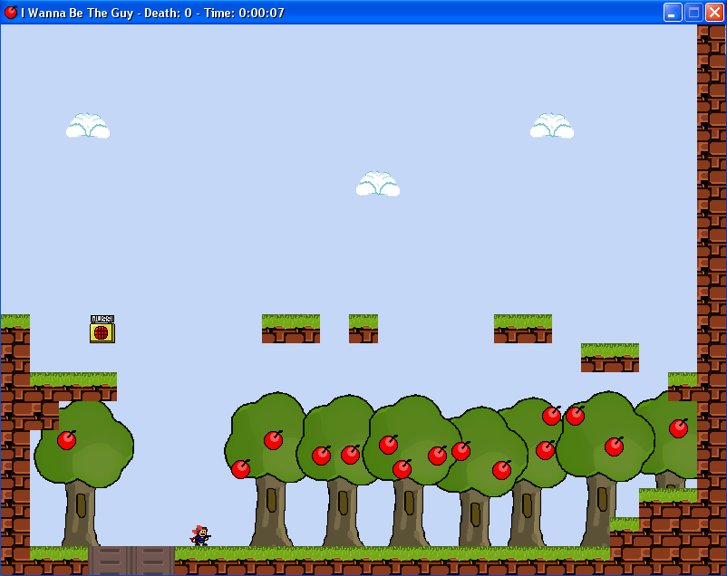

# gmrunner

Cross-platform C++20 runtime for **GameMaker 8.0 / 8.1 / 8.2** games, targeting **Windows, Linux, macOS, WebAssembly, and Android**.

## Showcase

<table>
  <tr>
    <td width="33%" align="center"></td>
    <td width="33%" align="center"></td>
    <td width="33%" align="center"></td>
  </tr>
  <tr>
    <td align="center"><sub><b>I Wanna Be The Guy Remastered</b></sub></td>
    <td align="center"><sub><b>I Wanna Kill The Kamilia 3</b></sub></td>
    <td align="center"><sub><b>Mushroom Kingdom Fusion</b></sub></td>
  </tr>
</table>

## Features

- **GM 8.0 / 8.1 / 8.2 Runtime**: Direct PE executable decryption and loading, GML bytecode compiler/VM with D&D action lowering, faithful 17-stage step loop, pixel-accurate/rotated collisions, particles, paths, and data structures.
- **Unified Graphics & Shaders**: OpenGL 3.3 Core (Desktop), OpenGL ES 3.0 (Android), and WebGL 2.0 (Web) backend with batched 2D, fixed-function D3D8/9 3D, surfaces/MRT, and an in-house D3D9 SM1–SM3 bytecode-to-GLSL transpiler.
- **Software Audio Mixer**: Cross-platform audio (`miniaudio`, `stb_vorbis`, `TinySoundFont`, tracker playback) with pitch/fade controls, 3D spatialization, and DSP effects.
- **Native Extension Shims**: Cross-platform C++ implementations for embedded `.gex` and runtime DLLs (`gm82core`, `gm82buf`, `gm82snd`, `gm82joy`, `gm82drag`, `gm82test`, `gm82dx8`/`gm82dx9`, `GMFMODSimple`, `SuperSound`, `MaizeMusic`, `CleanMem`).
- **Zero-Extraction Loading & Touch Controls**: Run `.exe` files, game folders, or streamed `.zip` archives directly, with persistent saves (OPFS/IDBFS on Web) and a built-in multi-touch virtual gamepad.

## Usage

```bash
gmrunner path/to/game.exe
gmrunner path/to/game_dir
gmrunner path/to/game.zip

# Additional options
gmrunner --save-dir ./saves --touch-overlay path/to/game.zip
gmrunner --sharp-scale path/to/game.zip
gmrunner --inspect path/to/game.exe
gmrunner --compile-check path/to/game.exe
gmrunner --help
```

`--sharp-scale` uses nearest-neighbor sampling at integer zoom and smooths pixel edges at fractional zoom when presenting the final game image. On the web, use `gmrunner.html?sharp-scale` or `gmrunner.html?game=game.zip&sharp-scale`.

## Building

Initialize submodules first:

```bash
git submodule update --init --recursive
```

Configure and build using CMake presets:

```bash
cmake --preset <preset>
cmake --build --preset <preset> --parallel
```

| Platform | Preset | Requirements / Notes |
| :--- | :--- | :--- |
| **Windows x64** | `windows-x64-release` | Clang + Ninja |
| **Linux x64** | `linux-x64-release` | GCC/Clang + Ninja; X11/Wayland/OpenGL/ALSA dev packages |
| **macOS** | `macos-release` | Apple Clang + Ninja (`macos-bundle-release` for `.app`) |
| **WebAssembly** | `wasm-release` / `wasm-jspi-release` | Emscripten (`EMSDK`); Asyncify (default) or JSPI (smaller binary) |
| **Android** | `android-arm64-release` | Android NDK (`ANDROID_NDK_HOME`) |

### Platform Notes

- **Packaging**: `./packaging/linux/package_linux.sh` (Linux tarball) · `./packaging/macos/package_macos.sh` (macOS `.app` + `.dmg`).
- **WebAssembly**: Serve `build/wasm-release/bin/` over HTTP (e.g. `python3 -m http.server -d build/wasm-release/bin 8080`) and open `gmrunner.html`. Supports dropping a game folder, `.zip`, or `.exe`, or autoloading via `?game=path/to/game.zip`.
- **Android**: For a full APK with game launcher and SAF `.zip`/`.exe` import, build the Gradle project in [`android/`](android/) via `./gradlew assembleRelease`.

## Architecture

The codebase is organized into modular C++20 libraries under `src/` (`base`, `platform`, `loader`, `gml`, `graphics`, `audio`, `extensions`, `runtime`, `app`). See [`docs/ARCHITECTURE_AND_ROADMAP.md`](docs/ARCHITECTURE_AND_ROADMAP.md) for the full architecture and compatibility matrix.

## License

MIT License — see [LICENSE](LICENSE).
