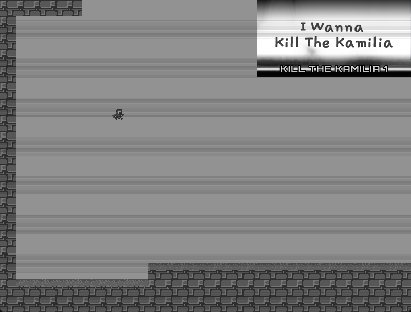
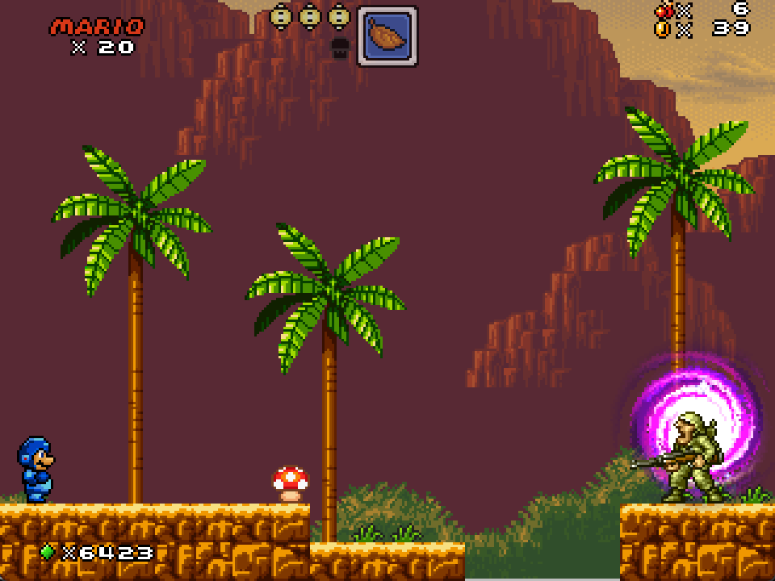

# gmrunner

Cross-platform C++20 runtime for **GameMaker 8.0 / 8.1 / 8.2** games, targeting **Windows, Linux, macOS, WebAssembly, and Android**.

## Showcase

<table>
  <tr>
    <td width="33%" align="center"></td>
    <td width="33%" align="center"></td>
    <td width="33%" align="center"></td>
  </tr>
  <tr>
    <td align="center"><sub><b>I Wanna Be The Guy Remastered</b></sub></td>
    <td align="center"><sub><b>I Wanna Kill The Kamilia 3</b></sub></td>
    <td align="center"><sub><b>Mushroom Kingdom Fusion</b></sub></td>
  </tr>
</table>

## Features

- **GM 8.0 / 8.1 / 8.2 Runtime**: Direct PE executable decryption and loading, GML bytecode compiler/VM with D&D action lowering, faithful 17-stage step loop, pixel-accurate/rotated collisions, particles, paths, and data structures.
- **Unified Graphics & Shaders**: OpenGL 3.3 Core (Desktop), OpenGL ES 3.0 (Android), and WebGL 2.0 (Web) backend with batched 2D, fixed-function D3D8/9 3D, surfaces/MRT, and an in-house D3D9 SM1–SM3 bytecode-to-GLSL transpiler.
- **Software Audio Mixer**: Cross-platform audio (`miniaudio`, `stb_vorbis`, `TinySoundFont`, tracker playback) with pitch/fade controls, 3D spatialization, and DSP effects.
- **Modular Native Extensions**: Cross-platform C++ extension registry replacing 32-bit Windows `.gex` and runtime DLLs (`gm82core`, `gm82buf`, `gm82snd`, `gm82joy`, `gm82drag`, `gm82test`, `gm82alpha`, `gm82gltf`, `gm82dx8`/`gm82dx9`, `GMFMODSimple`, `SuperSound`, `MaizeMusic`, `CleanMem`).
- **Zero-Extraction Loading & Touch Controls**: Run `.exe` files, game folders, or streamed `.zip` archives directly, with persistent saves (OPFS/IDBFS on Web) and a built-in multi-touch virtual gamepad.

## Usage

```bash
gmrunner [options] [game.exe | game_dir | game.zip]
```

On desktop, place the game EXE and its assets beside the runner (beside `gmrunner.app` on macOS), then double-click the runner. With no game path, it searches that folder first and the current working directory second. Within each folder it tries larger EXEs first and starts the first GameMaker game it can load.

| Option | Description |
| :--- | :--- |
| `-h`, `--help` | Show CLI usage and exit |
| `--inspect` | Parse executable and print asset/extension summary |
| `--compile-check` | Compile all GML/D&D scripts and exit |
| `--save-dir <path>` | Override writable save overlay directory |
| `--version <80\|81\|82>` | Override auto-detected GM version profile (`8.0`/`8.1`/`8.2` also accepted) |
| `--codepage <id>` | Windows codepage for GM 8.0 strings (e.g. `936`, `932`; default `1252`) |
| `--width <px>`, `--height <px>` | Initial window size (default `800` × `608`) |
| `--fullscreen` | Start in fullscreen mode |
| `--sharp-scale` | Nearest-neighbor at integer zoom; smooth pixel edges at fractional zoom |
| `--vsync` / `--no-vsync` | Override initial vertical sync on native platforms. Defaults to the game's setting. |
| `--touch-overlay` | Enable on-screen virtual touch controller |
| `--touch-layout <path>` | Load/save custom virtual touch layout file |
| `-v`, `--verbose` | Enable debug-level logging |
| `--trace-events` | Trace runtime event dispatch |
| `--trace-dll` | Trace external DLL / extension module calls |
| `--trace-vfs` | Trace virtual filesystem lookups |

On WebAssembly, URL query parameters support `?game=path/to/game.zip`, `?sharp-scale`, and `?codepage=<id>` (e.g. `gmrunner.html?game=game.zip&sharp-scale&codepage=936`).

## Building

Initialize submodules first:

```bash
git submodule update --init --recursive
```

Configure and build using CMake presets:

```bash
cmake --preset <preset>
cmake --build --preset <preset> --parallel
```

| Platform | Preset | Requirements / Notes |
| :--- | :--- | :--- |
| **Windows x64** | `windows-x64-release` | Clang + Ninja |
| **Linux x64** | `linux-x64-release` | GCC/Clang + Ninja; X11/Wayland/OpenGL/ALSA dev packages |
| **macOS** | `macos-release` | Apple Clang + Ninja (`macos-bundle-release` for `.app`) |
| **WebAssembly** | `wasm-release` / `wasm-jspi-release` | Emscripten (`EMSDK`); Asyncify (default) or JSPI (smaller binary) |
| **Android** | `android-arm64-release` | Android NDK (`ANDROID_NDK_HOME`) |

### Platform Notes

- **Packaging**: `./packaging/linux/package_linux.sh` (Linux tarball) · `./packaging/macos/package_macos.sh` (macOS `.app` + `.dmg`).
- **WebAssembly**: Serve `build/wasm-release/bin/` over HTTP (e.g. `python3 -m http.server -d build/wasm-release/bin 8080`) and open `gmrunner.html`. Supports dropping a game folder, `.zip`, or `.exe`, or autoloading via `?game=path/to/game.zip`.
- **Android**: For a full APK with game launcher and SAF `.zip`/`.exe` import, build the Gradle project in [`android/`](android/) via `./gradlew assembleRelease`.

## Extensions

Many GameMaker 8 games depend on 32-bit x86 Windows `.dll` libraries (via `external_define`/`external_call` or embedded `.gex` packages) for audio, shaders, buffers, networking, physics, and system integration. Because those native Win32 binaries cannot run on 64-bit, Linux, macOS, Android, or WebAssembly targets, `gmrunner` executes the extensions' bundled `.gml` scripts unmodified in the VM while routing native DLL calls through cross-platform C++ modules under `src/extensions/modules/`.

Each extension lives in its own self-contained directory and is auto-discovered by CMake—adding support for a new DLL requires no edits to the core engine. See [`src/extensions/modules/README.md`](src/extensions/modules/README.md) for the template and API guide.

## Architecture

The codebase is organized into modular C++20 libraries under `src/` (`base`, `platform`, `loader`, `gml`, `graphics`, `audio`, `extensions`, `runtime`, `app`). See [`docs/ARCHITECTURE_AND_ROADMAP.md`](docs/ARCHITECTURE_AND_ROADMAP.md) for the full architecture and compatibility matrix.

## License

MIT License — see [LICENSE](LICENSE).
