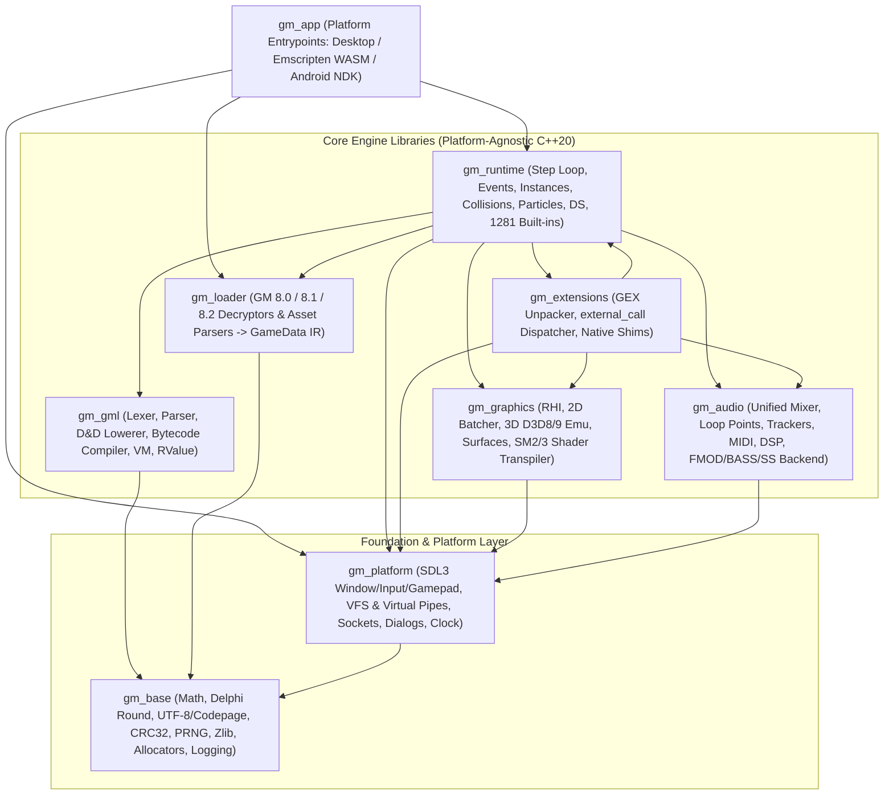

# gmrunner — Cross-Platform GameMaker 8.0 / 8.1 / 8.2 Runner Architecture & Roadmap

## 1. Executive Summary & Design Goals

**gmrunner** is a clean-room, modern **C++20** cross-platform runtime (MIT License) capable of executing compiled **GameMaker 8.0, 8.1, and 8.2** games across **Windows, Linux, macOS, WebAssembly, and Android** without requiring the original 32-bit x86 Delphi/DirectX 8/Win32 environment.

### Confirmed Architectural Decisions

- **Language & Layout**: C++20 (`gmrunner`, MIT License), CMake 3.24+ + Ninja, with `.h` and `.cpp` co-located in each module directory under `src/` and third-party libraries tracked as git submodules under `third_party/`.
- **Graphics RHI**: Abstract `IGraphicsDevice` backed by a unified **OpenGL 3.3 Core (Desktop) / OpenGL ES 3.0 (Android) / WebGL 2.0 (WebAssembly)** implementation.
- **D3D9 Shader Support (`gm82dx9`)**: In-house lightweight **D3D9 SM2/SM3 bytecode (`.vs3`/`.ps3`) + HLSL-SM3 (`.hlsl`) -> GLSL 330 core / 300 es transpiler** with `CTAB` reflection.
- **Audio Engine**: Pure open-source cross-platform software mixer (`miniaudio` + `libogg`/`libvorbis` + `libopenmpt` + `TinySoundFont` + custom DSP effects) powering vanilla GM8 audio and all audio DLL shims (`GMFMODSimple`, `gm82snd`, `SuperSound`, `MaizeMusic`).
- **Extension / DLL Strategy**: Native cross-platform C++ shims intercepting both embedded `.gex` DLLs (`gm82core`, `gm82buf`, `gm82dx9`, `gm82snd`, `gm82joy`, `gm82drag`, `gm82test`) and runtime `external_define`/`external_call` DLLs (`GMFMODSimple`, `SuperSound`, `MaizeMusic`, `CleanMem`), while executing extensions' bundled `.gml` wrapper scripts unmodified in the GML VM.
- **Rollout Order**: Build and verify Phases 0–6 on Windows x64 first while maintaining strict platform abstraction across PAL and CMake, then complete Linux, macOS, WebAssembly, and Android packaging in Phase 7.

---

## 2. Target Compatibility Matrix

| Feature / Behavior | GM 8.0 (`v800`) | GM 8.1 (`v810`) | GM 8.2 (`v810` + patched runner) |
| :--- | :--- | :--- | :--- |
| **EXE Payload Discovery** | Scan from PE overlay (`1,980,000` / `2,000,000` `+10,000` stride) for `1234321` | Byte scan from PE overlay (`3,800,004`) for interleaved magic `0xF7140067` | Same `0xF7140067` magic, trimmed stub (`3,174,000` / PE overlay start) |
| **Outer Encryption** | None | `DecryptWad`: UTF-16LE `"_MJD" + seed + "#RWK"` CRC-32 (no final XOR) + Marsaglia MWC XOR stream | Identical to GM 8.1 |
| **Inner Encryption** | `StreamE`: junk ints + 256-byte swap table + reverse sub/swap passes | Identical `StreamE` | Identical `StreamE` + optional appended zlib event/collision table (`sub_5F783F`) |
| **String Encoding** | Single-byte ANSI / Windows codepage (CP1252, CP936, CP932, etc.) | Internal UTF-8 (`CP_UTF8`); char ops use Unicode codepoints; `ansi_char`/`string_byte_*` use raw bytes | Identical to GM 8.1 |
| **Room Instances / Tiles** | Basic position/index/id/code | Adds instance `xscale`/`yscale`/`color`/`rotation` (`v811`) and tile `xscale`/`yscale`/`blend+alpha` | Adds `CreationEventOrder` toggle (Create vs Instance Creation Code) |
| **Built-in Functions** | Core GM 8.0 set | 1,281 built-ins (adds `YoYo_*`, `os_*`, `display_reset`, `sprite_save_strip`, `dot_product*`, `point_distance_3d`, `d3d_set_zwriteenable`, `ansi_char`, `string_byte_*`) | Same 1,281 built-ins; 14 built-in `joystick_*` stubbed (delegated to `gm82joy`); bundled `gm82*` GEX extensions |
| **Frame Pacing & Timing** | Legacy sleep-before-present | Legacy sleep-before-present | 1 ms timer resolution + Present-before-Sleep (eliminates 1-frame latency) |
| **Zero-Scale Collision** | Legacy `TMask` behavior | Legacy `TMask` behavior | Rejects collisions if `image_xscale * image_yscale == 0.0` |

---

## 3. High-Level System Architecture



### Module Structure (`.h` and `.cpp` co-located)

```text
gmrunner/
├── CMakeLists.txt
├── CMakePresets.json
├── LICENSE
├── README.md
├── docs/
│   └── ARCHITECTURE_AND_ROADMAP.md
├── third_party/                   # Git submodules: SDL, zlib, glad, (+ stb, miniaudio, ogg, vorbis, libopenmpt, TinySoundFont)
└── src/
    ├── base/                      # gm_base: types, math, encoding, hash, zlib_util, binary_reader, log
    ├── platform/                  # gm_platform: clock, platform, vfs (case-insensitive + virtual pipes + registry), window
    ├── loader/                    # gm_loader: PE scanner, GM80/81/82 decryptors, asset parsers, GameData IR
    ├── gml/                       # gm_gml: lexer, parser, D&D lowerer, bytecode compiler, VM, RValue
    ├── graphics/                  # gm_graphics: IGraphicsDevice, GlGraphicsDevice, 2D/3D renderers, surfaces, SM2/3+HLSL transpiler
    ├── audio/                     # gm_audio: software mixer, decoders, DSP, 3D, .wasd, FMODSIMPLEPW crypto
    ├── runtime/                   # gm_runtime: StepLoop, Room/Instance/Object, TMask collisions, mp_*, particles, ds_*, 1281 built-ins
    ├── extensions/                # gm_extensions: GEX loader, external_call dispatcher, native C++ shims
    └── app/                       # gmrunner executable: CLI + reentrant frame loop entrypoint
```

---

## 4. Core Subsystem Specifications

### 4.1 `gm_loader` — Multi-Version Binary Loader
- Parses PE32 section headers to locate overlay bounds resiliently across GM 8.0, 8.1, and 8.2 executables.
- Supports GM 8.0 (`1234321` magic + `v800`), GM 8.1 (`0xF7140067` interleaved magic + `DecryptWad` UTF-16LE CRC-32 + Marsaglia MWC XOR + `v810`), and GM 8.2 (trimmed stub + optional trailing precompiled event/collision zlib chunk `sub_5F783F`).
- Decrypts inner `StreamE` swap-table payload and parses all 16 asset sections (`Extensions`, `Triggers`, `Constants`, `Sounds`, `Sprites`, `Backgrounds`, `Paths`, `Scripts`, `Fonts`, `Timelines`, `Objects`, `Rooms`, `IncludedFiles`, `Help`, `Libraries`, `RoomOrder`), preserving sparse index holes (`exists == false`) and unpacking embedded `.gex` files.

### 4.2 `gm_gml` — GML Compiler, D&D Lowerer & Bytecode VM
- Compiles GML scripts, events, timelines, triggers, room/instance creation code, GEX `.gml` files, and dynamic `execute_string`/`object_event_add` into compact stack VM bytecode.
- Preserves exact GM 8.x semantics: `RValue` (`double` / `string`), truthiness `>= 0.5`, float comparison epsilon `1e-13` (`ds_set_precision` default `1e-7`), Delphi banker's rounding (`round()`), non-short-circuiting `&&`/`||`, `div`/`mod` truncating toward zero, `real * string` repetition, 64-bit rounded bitwise ops, `32000`-stride 2D arrays aliasing index `0` to scalar, verbatim strings with `#` newlines, and D&D action lowering with `argument_relative` stack.

### 4.3 `gm_runtime` — Simulation, Events, Collisions & Built-ins
- Executes the exact 17-stage step loop (`sub_60756C` / `sub_607868`) with `createCounter` mid-step guards, deferred destruction, room persistence, and instant step abort on room transition.
- `TMask` 2D `uint8` pixel masks (per-subimage or merged), AABB broadphase, exact scaled/rotated inverse-transform pixel checks, GM 8.2 zero-scale rejection, `solid` collision rollback -> event -> retry/rollback semantics, and `mp_*` motion planning.
- Byte-compatible `ds_*_write`/`ds_*_read` hex serialization (`ds_map` v401 `91010000`, `ds_list` v301 `2D010000`, `ds_grid` v601, etc.).
- Complete 13-module built-in library (1,281 built-ins + 331 constants).

### 4.4 `gm_graphics` — Unified GL 3.3 / GLES 3.0 / WebGL 2.0 RHI & Shader Transpiler
- Single OpenGL 3.3 Core / GLES 3.0 / WebGL 2.0 backend behind `IGraphicsDevice`.
- Fixed-function D3D8/9 uber-shader emulation (texture + vertex color, alpha test, fog, up to 8 lights, 1x1 white null-texture fallback), batched 2D renderer with 3-way depth merge (instances/tiles/particles), FBO surfaces & `application_surface`, 22 built-in room transitions, and `d3d_*` 3D pipeline (`C3D_Model` VBO caching).
- In-house D3D9 SM2/SM3 bytecode (`.vs3`/`.ps3`) + HLSL-SM3 (`.hlsl`) -> GLSL 330/300 es transpiler with `CTAB` uniform reflection and register mapping (`c0`–`c255`, `s0`–`s7`).

### 4.5 `gm_audio` — Unified Software Audio Engine
- `miniaudio` output + `dr_wav`/`dr_mp3`/`dr_flac` + `libogg`/`libvorbis` (sample-accurate loop points) + `libopenmpt` (`.mod`/`.s3m`/`.xm`/`.it`) + `TinySoundFont` (SF2 MIDI).
- Unified channel/group mixer (`Master` + 4 FMOD groups), smooth fades, pitch/resampling, software 3D spatialization, chainable DSP effects, FFT/wave snapshots, `FMODSIMPLEPW` SHA-1 XOR stream crypto, and `.wasd` zlib sound packs.

### 4.6 `gm_extensions` — GEX & External DLL Interception
- Intercepts both `kind=1` embedded GEX DLLs and runtime `external_define`/`external_call` bindings (tolerating the `dll_stdcall`-vs-`cdecl` ABI quirk in `gm82joy`/`gm82snd`).
- **Tier 1 Shims**: `gm82core`, `gm82buf`, `gm82dx9`, `gm82snd`, `gm82joy`, `gm82drag`, `gm82test`, `D3DX9_43`.
- **Tier 2 Shims**: `GMFMODSimple` + `fmodex`, `SuperSound`, `MaizeMusic` + `bass`/`bass_fx`, `CleanMem`.

### 4.7 `gm_platform` — PAL, Case-Insensitive VFS & Multi-Platform Realities
- SDL3 windowing, keyboard (`vk_*`), mouse, gamepad/rumble, drag-drop, clipboard, dialogs.
- Case-insensitive backslash-normalizing VFS with writable save overlay, ephemeral `temp_directory`, in-memory virtual named pipes (`\\.\pipe\gm82netpipe.*`), wildcard `find_files`, and emulated Windows registry.
- Reentrant `tick_frame()` loop designed for Emscripten `emscripten_set_main_loop_arg` + JSPI/Asyncify (WebAssembly) and Android pause/resume & EGL context recovery.

---

## 5. Phased Development Roadmap

| Phase | Scope | Key Verification Target(s) |
| :---: | :--- | :--- |
| **Phase 0** | Repo foundation, CMake presets, submodules (`SDL3`, `zlib`, `glad`), `gm_base`, `gm_platform`, `gm_graphics` RHI, `gm_app` skeleton | Empty OpenGL 3.3 Core window + CLI `--help` on Windows x64 (**Complete**) |
| **Phase 1** | `gm_loader`: PE overlay scanner, GM 8.0 / 8.1 / 8.2 decryptors, all 16 asset parsers, GM 8.2 event table, GEX unpacker, `--inspect` CLI | `--inspect` cleanly parses all 7 sample EXEs (8.0, 8.1, 8.2) |
| **Phase 2** | `gm_gml`: GM8 lexer, symbol resolver, parser, D&D action lowerer, constant folder, bytecode compiler, VM, `--compile-check` CLI | `--compile-check` compiles all scripts/events/GEX GML across all 7 samples |
| **Phase 3** | `gm_runtime` core simulation (17-stage step loop, `TMask` collisions, `solid`, `ds_*`, particles, core built-ins), 2D renderer, vanilla audio | `GM80_yuuutu` playable end-to-end |
| **Phase 4** | External DLL interception, full `gm_audio` mixer/trackers/DSP, shims for `GMFMODSimple`, `SuperSound`, `MaizeMusic`, `CleanMem`, full GM 8.1 built-ins | `GM80_parasoko`, `GM81_nikaple`, `GM81_kamilia` playable |
| **Phase 5** | Fixed-function 3D `d3d_*` + `C3D_Model`, GM 8.2 runner behaviors, shims for `gm82core`, `gm82buf`, `gm82snd`, `gm82joy`, `gm82drag`, `gm82test` | `GM82_guy`, `GM82_renex` (3D `.g3z` via virtual pipe + `.mod`/`.s3m` music) playable |
| **Phase 6** | `gm82dx9` extended graphics shim + in-house D3D9 SM2/SM3 bytecode & HLSL-SM3 -> GLSL transpiler | `GM82_MKFusion` (`.hlsl`/`.ps3` shaders, 5,400+ external assets, `ds_list_write` saves) playable |
| **Phase 7** | Linux, macOS, WebAssembly (Emscripten + WebGL 2 + OPFS/IDBFS + JSPI/Asyncify), Android (NDK + GLES 3 + touch overlay), performance polish | All 7 sample games verified across all 5 platforms |
